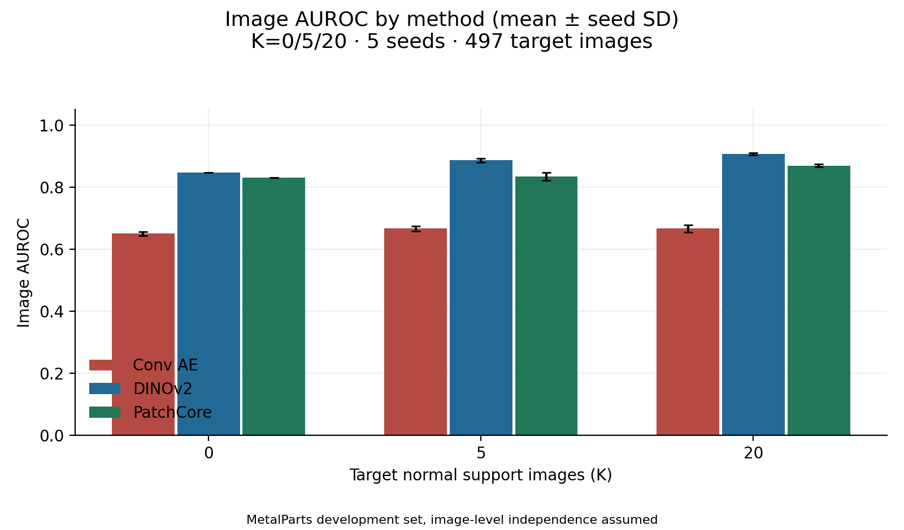

# MetalParts defect detection under real image shifts

Can five or twenty normal images help a defect detector adapt to new lighting, position, rotation, scale and backgrounds?

This semester project compares a convolutional autoencoder built on frozen DINOv2 features with budgeted DINOv2 memory and PatchCore variants.

[Final report](docs/MetalParts%20Final%20Project%20Report.docx) · [Presentation](docs/MetalParts%20Presentation.pptx) · [Detailed results](comparison/summary.md) · [Protocol](docs/protocol.md)

## Results

| Mean image AUROC | K = 0 | K = 5 | K = 20 |
|---|---:|---:|---:|
| Conv AE | 0.650 | 0.666 | 0.666 |
| DINOv2 memory variant | 0.846 | 0.886 | **0.906** |
| PatchCore variant | 0.829 | 0.834 | 0.869 |

DINOv2 memory gave the strongest image ranking. PatchCore achieved the highest balanced accuracy at the frozen source threshold at K=20 (0.755). The autoencoder gained little beyond five examples.

## What was implemented

- Convolutional feature reconstruction with decoder adaptation and source-normal replay.
- Memory baselines with a fixed bank of 2,048 patch features.
- Five paired main seeds and three ablation seeds across six image conditions.
- A controlled experiment using ten adaptation and ten calibration normals.
- Leakage checks, saved result tables, bootstrap intervals and a predeclared permutation test.

## Repository guide

| Folder | Contents |
|---|---|
| common/ | Data loading, metrics, runner, reporting and Kaggle notebook |
| models/ | Three model implementations and model-specific reporting outputs |
| data/manifests/ | Fixed data roles, support draws and audit records |
| comparison/ | Aggregate tables, figures and paired statistics |
| docs/ | Final report, presentation, protocol and supporting documentation |

## Reproduction and available artifacts

This repository includes code, manifests, aggregate results and selected plots. Raw images, pretrained weights, fitted checkpoints, full prediction files and the original run archives are stored separately. A fresh clone supports reading the findings and reviewing the implementation.

The recorded local workflow used Python 3.13. Kaggle used PyTorch 2.11.0 with CUDA. The saved documentation records the experimental setup; no new dependency lock has been tested.

1. Obtain data from [AmazonScience/RobustAD](https://huggingface.co/datasets/AmazonScience/RobustAD), revision 82c642b2d18be60f2dab104f8dd4dea1f4ccfacb. The dataset license is CC BY 4.0.
2. The local downloader is `python common/p1_download.py`.
3. Explore the experiment CLI with `python common/run.py --help`.
4. See `common/kaggle_run.ipynb` for the recorded Kaggle workflow. Its saved settings target the follow-up queue, which needs Q1 outputs. Configure a fresh Q1 run when starting from scratch.
5. `python common/report.py --report` requires the separately preserved per-image predictions and ledgers.

## Limitations

Results are **development evidence for one metal-part family**. Both memory baselines are budgeted variants. Physical capture identities remain unverified, so image-level confidence intervals may be optimistic. Support draws overlap across seeds. Source thresholds use 11–14 normal images, and the calibration experiment uses ten normals.

Some older documents record the completed workflow and historical local paths. The original exact run bundle and complete evidence remain in the local archive.

## Team

Amrit Jaiswal · Aryan Babu · Divyansh Singodia

## References

- [RobustAD paper](https://openaccess.thecvf.com/content/CVPR2025W/VAND/papers/Pemula_Robust_AD_A_Real_World_Benchmark_Dataset_For_Robustness_in_CVPRW_2025_paper.pdf)
- [DINOv2](https://github.com/facebookresearch/dinov2)
- [PatchCore paper](https://openaccess.thecvf.com/content/CVPR2022/html/Roth_Towards_Total_Recall_in_Industrial_Anomaly_Detection_CVPR_2022_paper.html)
