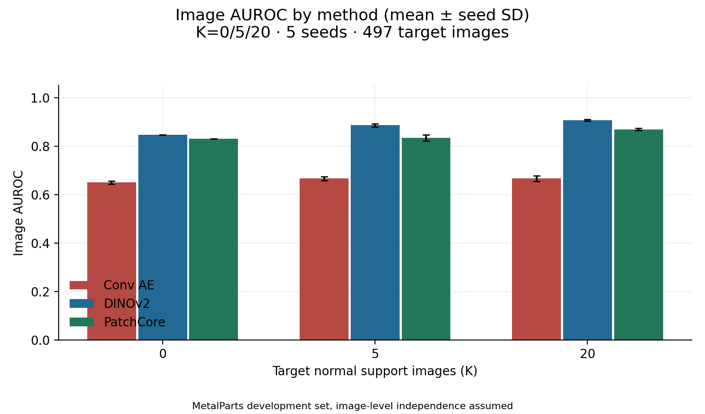
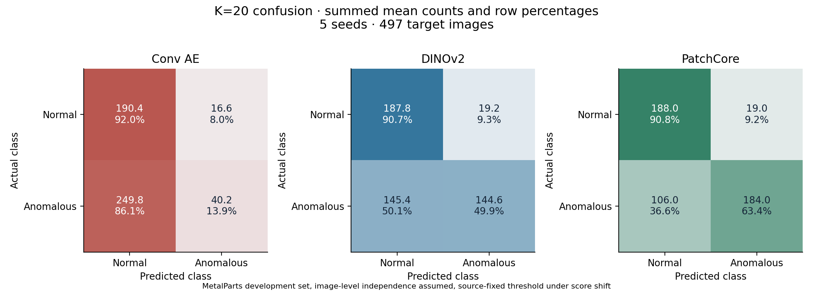
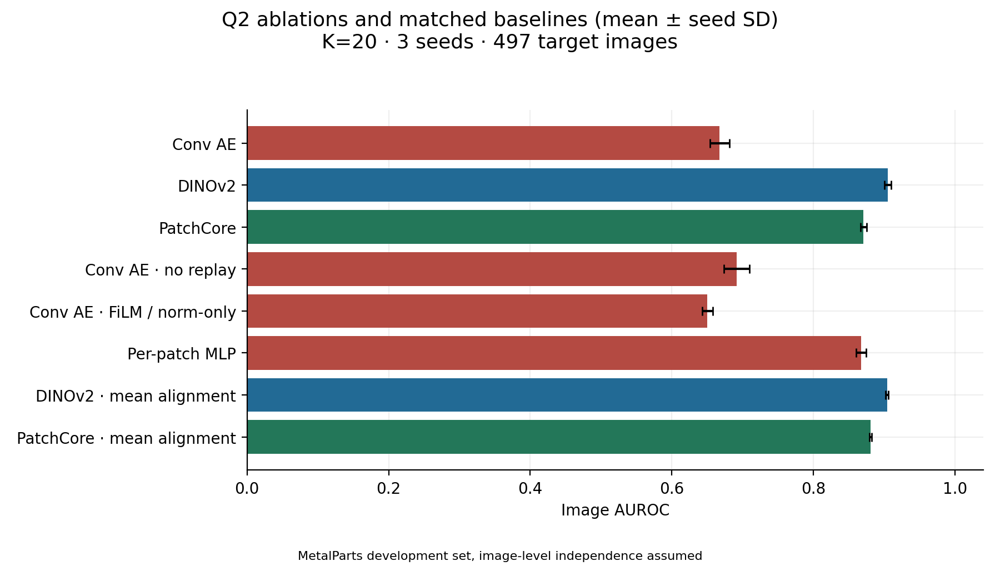
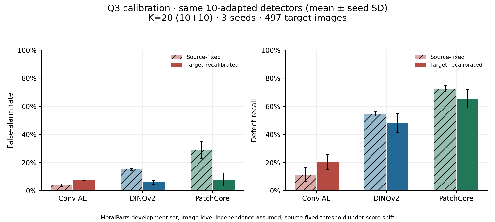

# MetalParts reporting summary

All results use the 448 px saved predictions and the frozen MetalParts evaluation sets.
Headline metrics are **balanced accuracy and image AUROC**. Accuracy can hide class imbalance.
Positive class is anomalous. TP = detected anomaly, FN = missed anomaly, FP = false alarm, TN = correct normal.
At K=0/5/20, score > the saved source-normal 95th-quantile threshold predicts anomaly.
These decisions are labelled **source-fixed threshold under score shift**.
Q3 uses the two saved thresholds on the same 10-adapted detector, with ten separate target calibration normals.
Counts are calculated per condition and seed. The sum adds conditions within each seed before averaging.
Rates are per-run ratios: TPR = TP/(TP+FN), TNR = TN/(TN+FP), FPR = 1−TNR, FNR = 1−TPR.
Precision = TP/(TP+FP), accuracy = (TP+TN)/n, balanced accuracy = (TPR+TNR)/2, F1 = 2TP/(2TP+FP+FN).
Precision is unavailable when no positive is predicted. Tables include the number of defined seed values.
Macro means weight six conditions equally. Per-condition and macro SDs are descriptive sample SDs across seeds.
AUROC and AUPRC (average precision) are computed from saved scores. FPR@95%TPR uses the smallest achieved FPR at TPR ≥95%.
ROC figures average seed and condition curves on a 201-point FPR grid using interpolation for display.
Pixel AUROC and AUPRO (FPR ≤0.30) use the saved 448×448 evaluations: bilinear score maps, nearest-neighbor masks, exact tied-score region weighting.
Score overlays compare within-seed, within-condition percentile ranks. Per-model plots use recorded raw scores.
Per-method panels use the first eligible saved-map image ID per condition and outcome, breaking ties by seed.
Shared example figures use Conv AE outcomes and show the same image and seed for every method.

| Target test denominators | Normal | Anomalous |
|---|---:|---:|
| test1 | 20 | 50 |
| test2 | 28 | 41 |
| test3 | 41 | 46 |
| test4 | 76 | 77 |
| test5 | 21 | 36 |
| test6 | 21 | 40 |

| Method | K | Image AUROC mean ± SD | Balanced accuracy mean ± SD | Pixel AUROC mean ± SD | AUPRO mean ± SD |
|---|---:|---:|---:|---:|---:|
| Conv AE | 0 | 0.650 ± 0.006 | 0.584 ± 0.011 | 0.939 ± 0.003 | 0.829 ± 0.005 |
| Conv AE | 5 | 0.666 ± 0.009 | 0.536 ± 0.011 | 0.948 ± 0.002 | 0.849 ± 0.003 |
| Conv AE | 20 | 0.666 ± 0.012 | 0.542 ± 0.011 | 0.948 ± 0.003 | 0.850 ± 0.004 |
| DINOv2 | 0 | 0.846 ± 0.000 | 0.696 ± 0.000 | 0.965 ± 0.000 | 0.896 ± 0.000 |
| DINOv2 | 5 | 0.886 ± 0.006 | 0.679 ± 0.008 | 0.968 ± 0.001 | 0.908 ± 0.002 |
| DINOv2 | 20 | 0.906 ± 0.004 | 0.707 ± 0.006 | 0.970 ± 0.001 | 0.911 ± 0.004 |
| PatchCore | 0 | 0.829 ± 0.000 | 0.672 ± 0.000 | 0.979 ± 0.000 | 0.923 ± 0.000 |
| PatchCore | 5 | 0.834 ± 0.012 | 0.667 ± 0.018 | 0.971 ± 0.002 | 0.910 ± 0.005 |
| PatchCore | 20 | 0.869 ± 0.004 | 0.755 ± 0.005 | 0.973 ± 0.002 | 0.911 ± 0.005 |

DINOv2 leads on K=20 image AUROC. Conv AE changes little from K=5 to K=20.
Post-hoc finding from the MetalParts test results: at K=20, the matched MLP reached 0.868 AUROC versus 0.667 for Conv AE.
PatchCore calibration changes false alarms from 29.0% to 7.9% and recall from 72.4% to 65.4%.
The saved verification matched all nine headline AUROCs and all ten table spot checks.
The memory variants use deterministic K=0 aliases, so their K=0 seed SD is zero.
The saved Conv AE minus DINOv2 K=20 difference is -0.240 (95% CI -0.293 to -0.187). Predeclared permutation p < 1e-4 (minimum attainable with 10,000 permutations).

False-alarm heatmap estimate: up to six normals and 18 maps, 2–5 GPU minutes with assets staged. Approval pending.

**Limitations.** Six development conditions and small, imbalanced test sets.
Capture identity is unverified. Image-level independence is assumed and the intervals may be optimistic.
Source thresholds use 11–14 normal images, support draws overlap across seeds, and score shift affects operating rates.
Ten calibration normals give a coarse estimate. Saved maps contain no false-alarm examples.
At K>0, balanced accuracy uses the frozen source threshold, so it can change with score scale and ranking. Conv AE at about 0.54 is near chance.
PatchCore and DINOv2 memory are project-specific, budgeted variants. Scoring latency uses saved preflight timings on cached source features.
